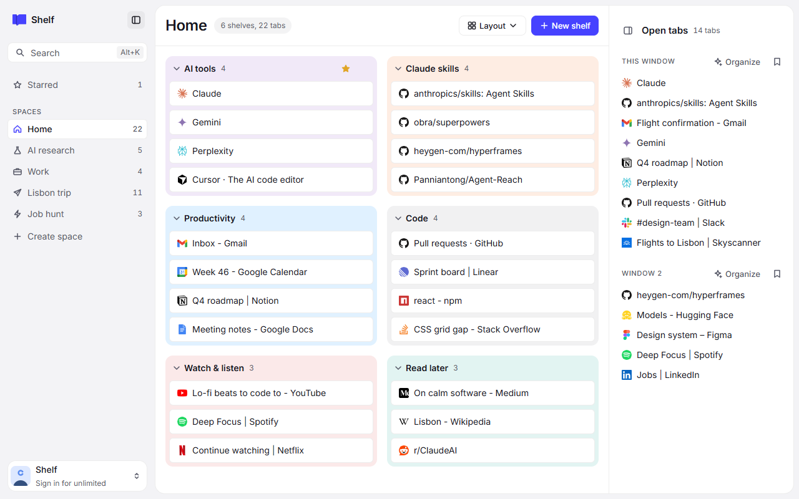
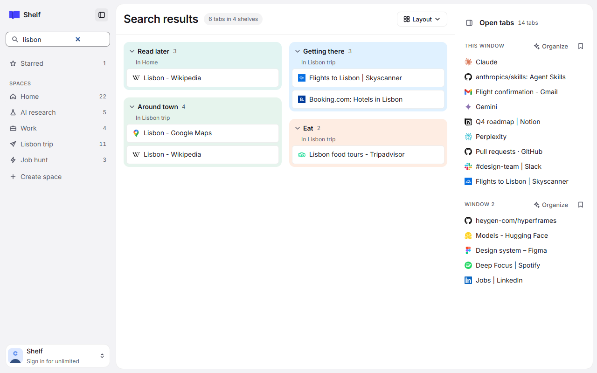
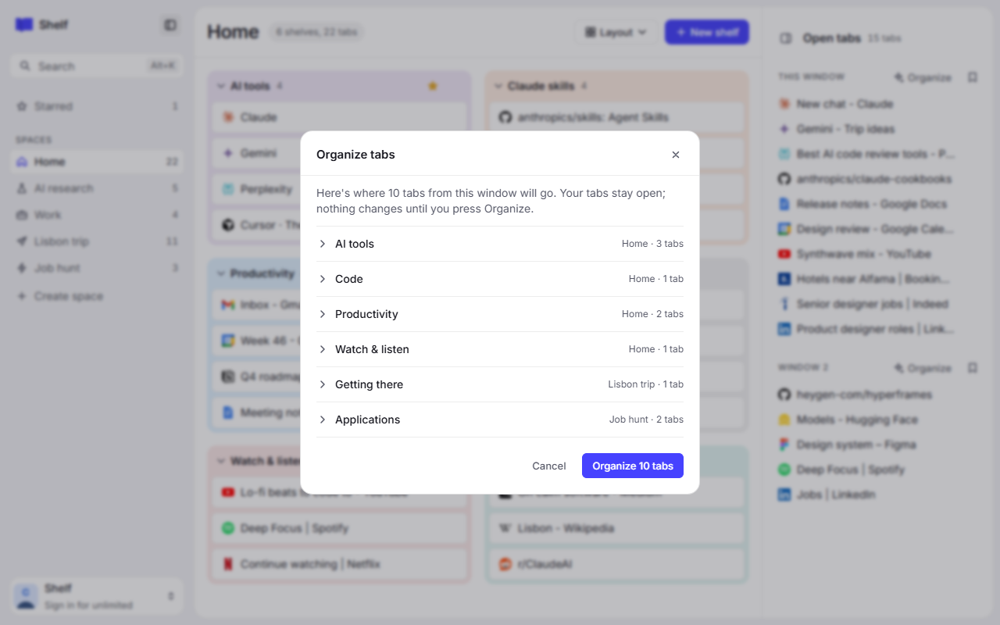
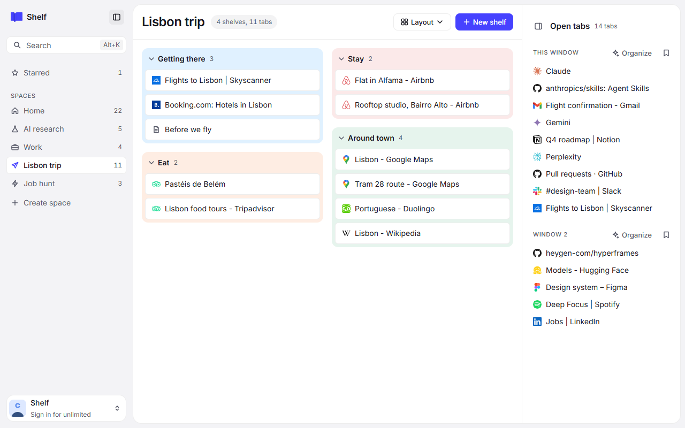
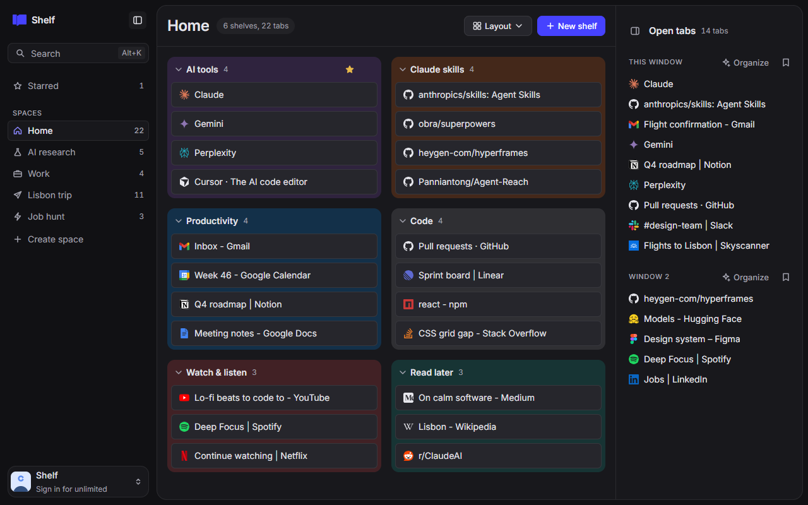

  

<h1 align="center">Shelf</h1>

  <strong>Keep the tabs you care about out of the way, and one click from coming back.</strong> 
  A tab manager for Chrome and Firefox. Listed in the stores as <em>Auto Shelf</em>.

  
  
  

  

## What is Shelf?

Shelf turns a pile of open tabs into a tidy board. Save a window into a named **shelf**, group shelves into **spaces** (Work, Personal, a side project), and reopen anything with one click. It works in Chrome and Firefox, and in Chrome, Edge and Firefox the dashboard can replace your new-tab page so your shelves are there every time you open a tab.

It is free to start, and no account is needed.

## Screenshots

| Search across every space | One-click Organize (Pro) |
| :---: | :---: |
|  |  |

| A space for a trip | Dark theme |
| :---: | :---: |
|  |  |

## Features

### Free
- **3 spaces and 20 shelves.** Nothing you save is ever deleted if you go over; you just can't add more until you upgrade or tidy up.
- **Save a whole window into a shelf.** Name it, save every tab at once, and close them in the same step if you like.
- **Right-click saving.** Save any page or link straight to a shelf.
- **Drag and drop**, with a keyboard route too. Your open tabs sit beside the board; drop one on a shelf, or drop a shelf on another space to move it.
- **Notes, colours, layouts and stars** to arrange the board the way you think.
- **Search everything.** Press `Alt + K` and Shelf matches titles, addresses and note text across every space as you type.
- **Side panel** in Chrome and the sidebar in Firefox, so you can save and reopen tabs without leaving the page you are on.
- **Keyboard shortcuts you can change.** Search, settings, the sidebar, your open tabs and jumping to a space all have one.
- **Sync with a free account.** Spaces, shelves, tabs and notes follow you to every browser you sign in on, usually within seconds.
- **Backups in plain JSON.** Export every space, or just the one you have open, and import it again later.
- **Light and dark**, following your system setting or your choice.

### Pro
Everything in Free, plus:
- **Unlimited spaces and shelves.**
- **Organize.** Sort a window's tabs into shelves in one click (YouTube to Watch & Listen, GitHub to Code). You see the plan first, and it all happens on your device.
- **Share spaces, end-to-end encrypted.** Invite people by email to view or edit a space. Shared spaces are encrypted in your browser, so Shelf's server cannot read them.

### Coming soon
Colour themes (two free, more and a custom colour with Pro), separate heading and body fonts, and an interface scale from 80% to 115%. See the [roadmap](#roadmap).

## Pricing

| | Free | Pro |
| --- | --- | --- |
| Price | $0 forever | **$4 / month** or **$39 / year** |
| Spaces and shelves | Up to 3 spaces, 20 shelves | Unlimited |
| Sync across browsers | Yes, with a free account | Yes |
| Organize | - | Yes |
| Encrypted shared spaces | - | Yes |

Pro includes a **1-month free trial**. Prices are shown with any tax at checkout, and payments are handled by [Paddle](https://www.paddle.com), the merchant of record, so Shelf never sees your card details. You can cancel any time from the account menu and nothing you have saved is deleted. Full details are on the [pricing page](https://autoshelf.site/pricing.html).

## Privacy

- **No analytics, no tracking, no ads.** Shelf does not measure how you use it.
- **Without an account, nothing leaves your browser.** What you save lives in your browser's extension storage.
- **An account is optional.** Signed in, your own spaces sync between your browsers through Shelf's server, which keeps them encrypted at rest. That is not end-to-end encryption: the server holds the key, which is what lets a new browser get your shelf back.
- **Shared spaces are end-to-end encrypted** (AES-256-GCM). The server only stores and forwards data it cannot read.
- **Shelf reads the titles and addresses of your open tabs to list them,** but does not store them unless you save them, and does not read the content of any page.
- **Your data is yours.** Export it as plain JSON, delete your synced copy from Settings, or uninstall and your browser removes everything stored locally.

The full policy, including every permission and every service that processes data, is at [autoshelf.site/privacy.html](https://autoshelf.site/privacy.html).

## Roadmap

**Now**
- Custom themes and fonts
- Interface scale
- Feedback from inside the app

**Next**
- Sign in with Apple
- Restore from cloud history
- A sync on/off switch

**Later**
- A themes and plugins community
- Opt-in, smarter sorting

The live version is on the [community page](https://autoshelf.site/community).

## Feedback and support

A person reads every message.

- **Request a feature or report a problem:** [autoshelf.site/community](https://autoshelf.site/community)
- **Email:** [hello@autoshelf.site](mailto:hello@autoshelf.site)
- **GitHub Issues:** [open an issue](../../issues/new/choose) here. Please do not include personal data or anything you saved in Shelf.

## Source code

Shelf's source code is not public. This repository holds the README, images and issue templates only.

## Notice

Copyright (c) 2026 Shelf. All rights reserved. See [NOTICE.md](NOTICE.md).
